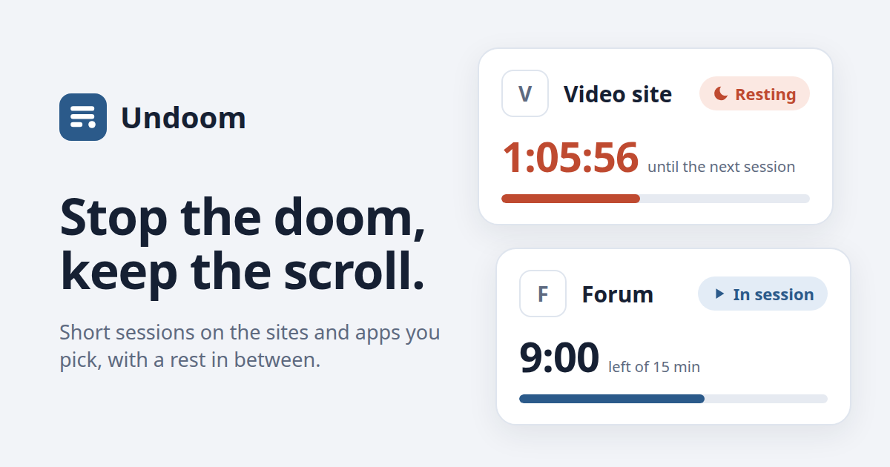

# Undoom

Undoom limits how long each session on a site or
app can last and requires a rest before the next one, synced across your Firefox
and Android devices.

- [Download Firefox extension](https://github.com/seriaati/undoom/releases/download/latest/undoom-firefox.xpi)
- [Download Android apk](https://github.com/seriaati/undoom/releases/download/latest/undoom.apk)

## Motive

I scroll social medias occasionally, but algorithms today are so well-designed, that your brain just can't stop your eyes from sticking on to the apps. I don't think banning the apps completely is a good solution, because that just makes you want to scroll even more. For me, scrolling for a little while is fine, but not scrolling for 1~2 hours and waste my precious time. Hence Undoom's mechanism: You can scroll, but you will be cut off after a set amount of time, then you can keep scrolling once you took a break (to do other more meaningful things).

I've tried other blocking apps before, but they have problems:

1. They work by setting an amount of time you can use the app per day, but what happens is that you just use up all the quota in one long scrolling session. The point of Undoom is that you can scroll, for a short period of time. You can practically use the apps for infinite number of times, as long as you take the break in-between.
2. I don't really trust third-party apps to have accessibility permission on my phone.
3. They have paywalls for features that I want to use (like grouping apps).
4. They don't have cross-platform sync of sites and usage time.

## Screenshots

<table>
  <tr>
    <th colspan="2">Android</th>
  </tr>
  <tr>
    <td align="center"></td>
    <td align="center"></td>
  </tr>
  <tr>
    <th colspan="2">Firefox</th>
  </tr>
  <tr>
    <td align="center"></td>
    <td align="center"></td>
  </tr>
</table>
