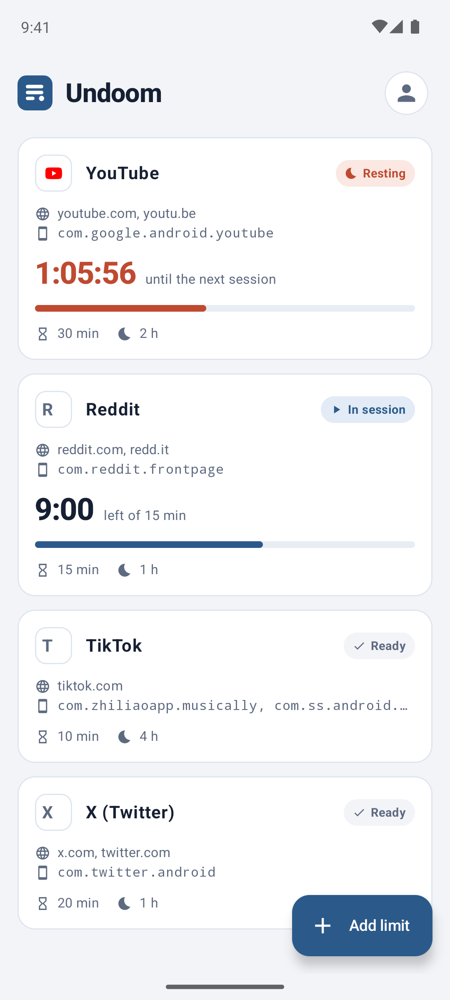
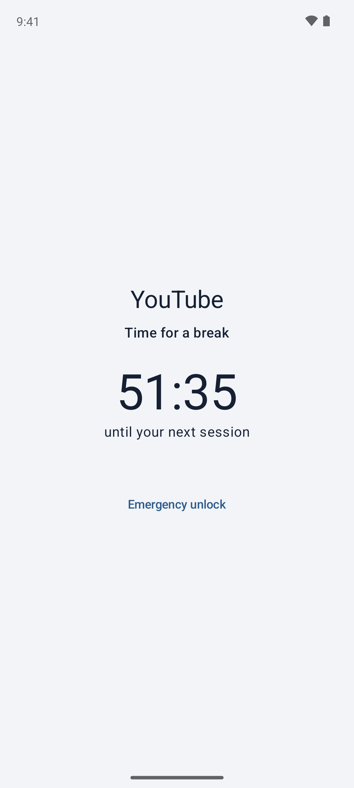
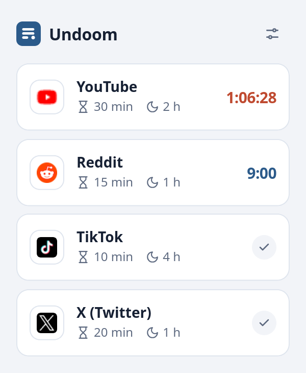

# Undoom

Stop the doom, keep the scroll. Undoom limits how long each session on a site or
app can last and requires a rest before the next one, synced across your Firefox
and Android devices.

- [Download Firefox extension](https://github.com/seriaati/undoom/releases/download/latest/undoom-firefox.xpi)
- [Download Android apk](https://github.com/seriaati/undoom/releases/download/latest/undoom.apk)

## Screenshots

<table>
  <tr>
    <th colspan="2">Android</th>
  </tr>
  <tr>
    <td align="center"></td>
    <td align="center"></td>
  </tr>
  <tr>
    <th colspan="2">Firefox</th>
  </tr>
  <tr>
    <td align="center"></td>
    <td align="center"></td>
  </tr>
</table>
